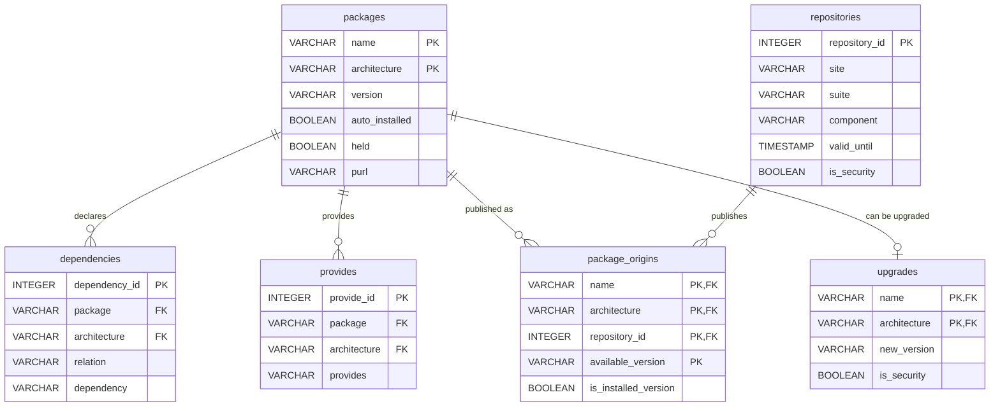

# A ready-made database

[`docs/apt_database.sql`](https://github.com/adriens/duckdb-apt/blob/main/docs/apt_database.sql) snapshots everything the extension reads into a DuckDB database: one table per function, with primary and foreign keys, a comment on every table, view and column, and views answering the usual questions.

```sh
duckdb apt.duckdb -c ".read docs/apt_database.sql"

# another system
duckdb apt.duckdb -cmd "SET VARIABLE apt_root = '/mnt/image'" -c ".read docs/apt_database.sql"
```

It takes about a second. Re-running the script replaces the snapshot. The resulting file holds plain tables: it can be opened without the extension, shared with a security team, or archived to compare snapshots over time.

## Tables



| Table | Content | Key |
| --- | --- | --- |
| `snapshot` | When and from which system the database was built, apt and extension versions | |
| `packages` | Installed packages | `(name, architecture)` |
| `dependencies` | Dependencies, one row per alternative | `dependency_id`, references `packages` |
| `provides` | Virtual packages provided | `provide_id`, references `packages` |
| `sources` | Configured repositories | `source_id` |
| `repositories` | Downloaded repository indexes | `repository_id` |
| `package_origins` | Versions of installed packages published by each repository | references `packages` and `repositories` |
| `upgrades` | Pending updates | `(name, architecture)`, references `packages` |
| `history` | Installs, upgrades and removals | `history_id` (no foreign key: removed packages stay in the history) |

The [function reference](functions.md) describes every column; inside the database, `duckdb_columns()` shows the same descriptions:

```sql
SELECT table_name, column_name, comment FROM duckdb_columns() WHERE table_name = 'packages';
```

## Views

| Topic | View | Answers |
| --- | --- | --- |
| Overviews | `security_posture` | One row of key indicators, for dashboards and reports |
| | `package_overview` | One row per package: orphaned or not, installed from which suites, pending update, security flag, dependents |
| Supply chain | `orphaned_packages` | Installed packages no repository provides: apt never updates them |
| | `packages_not_in_repositories` | Installed versions no repository publishes (local builds, leftovers) |
| | `third_party_packages` | Packages installed on purpose that neither Ubuntu nor Debian publish |
| | `maintainers` | Packages per maintainer, with how many are third-party or orphaned |
| | `risky_sources` | Repositories with signature checks disabled, no pinned key, or plain HTTP |
| | `repository_usage` | How many installed packages each repository publishes |
| | `expired_repositories` | Indexes past their `Valid-Until` date when the snapshot was taken |
| Patching | `security_updates` | Pending updates from security repositories |
| | `held_packages` | Packages held with `apt-mark hold`, and the update they miss |
| Dependencies | `dependency_edges` | Dependency graph, virtual packages resolved to their providers |
| | `package_dependents` | Direct dependents of each package |
| | `unsatisfied_dependencies` | Hard dependencies nothing satisfies (empty on a healthy system) |
| | `autoremove_candidates` | Automatically installed packages nothing needs anymore |
| | `disk_usage_by_section` | Installed size per section |
| History | `recent_changes` | The last 30 days of history |
| | `monthly_activity` | One row per month, one column per action (a `PIVOT`) |
| | `user_activity` | Changes per user, automatic ones grouped |
| | `failed_transactions` | apt runs that reported an error |

Time-based views use the snapshot time rather than `now()`, so an archived database keeps giving the same answers.

```sql
FROM security_posture;

SELECT name, version, installed_from, available_update
FROM package_overview
WHERE security_update;

FROM monthly_activity ORDER BY month DESC LIMIT 6;
```
